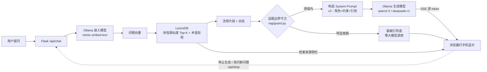

# 基于 Ollama 的本地大模型 + RAG 交通出行法规智能问答系统

一个**完全本地运行**的领域问答系统：用户用自然语言提问交通出行法规问题或描述具体情形，系统从自建的中国交通出行法规知识库中检索相关条款，构造带引用的 System Prompt，再由本地大模型生成可溯源的回答。知识范围覆盖**道路交通、高速公路、铁路高铁、城市轨道交通（地铁/轻轨）、民用航空**等出行方式。

系统另带三项交互增强：**无关问题会被温和地引导回交通出行法规话题**，**模型回答过程中输入框始终可用、可随时打断或改问新问题**，**打断时先答完上一题再回答新问题**。

> **重要说明**：知识库依据《中华人民共和国道路交通安全法》《道路交通安全法实施条例》《道路交通安全违法行为记分管理办法》（公安部令第 163 号，2022-05-01 施行）、《中华人民共和国铁路法》《铁路安全管理条例》《城市轨道交通运营管理规定》《中华人民共和国民用航空法》《民用航空安全保卫条例》《无人驾驶航空器飞行管理暂行条例》等公开法规整理。本系统用于教学实验与学习参考，**不构成法律意见**，具体执法以相关主管部门认定及官方最新文本为准。

---

## 一、功能特性

| 实验要求 | 本系统实现 |
| --- | --- |
| 领域针对性 | 交通出行法规场景，94 条知识片段，覆盖 14 个类别（含铁路高铁、地铁、民航），禁止使用通用示例数据 |
| 知识库构建 | 每条含 `id / 标题 / 内容 / 出处 / 分类 / 标签`，按句子边界分段并保留重叠 |
| 向量化与存储 | Ollama `nomic-embed-text` → LanceDB 本地持久化 |
| 检索算法 | 余弦相似度、Top-K、阈值过滤、同源限流、2-gram 去重、多段融合、术语加权混合检索（含关键词前置召回） |
| 提示词工程 | 3 个版本 Prompt（v1 朴素 / v2 角色 / v3 严谨），默认 v3 强制引用编号与拒答规则，并按问题类型自适应回答详细程度 |
| RAG 全流程 | 问题 → 嵌入 → 检索 → **话题边界判定** → Prompt → 模型生成 → 流式返回 |
| 前端交互 | Flask + 原生 HTML/CSS/JS：输入框、输出区、打字机流式、多轮对话、检索来源侧栏、引用跳转 |
| **话题边界约束** | 明显离题的问题以委婉语气说明能力边界并引导回交通出行法规，**不调用大模型**（秒回） |
| **可打断流式** | 生成中输入框常驻可编辑；「停止生成」按钮可中断；发送新问题则排队，等当前回答完成后再答 |
| 工程化 | 配置集中管理、环境检测脚本、一键建库、pytest 测试、dev/prod 建议 |

---

## 二、项目结构

```text
traffic-law-rag/
├── app.py                          # Flask 后端：页面 + SSE 流式 + /api/stop 中断 + 会话管理 + 限流
├── config.py                       # 全局配置（模型/路径/检索/守卫/会话/防护参数，环境变量可覆盖）
├── session_store.py                # 会话历史 JSON 文件持久化（重启不丢 + 过期清理）
├── rate_limit.py                   # 令牌桶限流 + 访问日志
├── requirements.txt                # 依赖清单
├── data/
│   ├── traffic_law_knowledge.json  # 94 条交通出行法规知识片段（含出处）
│   ├── sessions.json               # 会话历史（运行时生成，已 gitignore）
│   ├── access.log                  # 访问日志（运行时生成，已 gitignore）
│   └── lancedb/                    # 向量库（由脚本生成，已 gitignore）
├── knowledge_base/
│   ├── loader.py                   # 知识加载、校验、分段（chunk）
│   └── vector_store.py             # LanceDB 建库、余弦检索、Top-K、去重融合、术语加权、二次精排
├── rag/
│   ├── embedder.py                 # Ollama 嵌入接口封装（含新旧 API 兼容）
│   ├── llm.py                      # Ollama 生成接口封装（流式/非流式，支持 should_stop 中断）
│   ├── prompts.py                  # 三版本 Prompt 模板与上下文构造
│   ├── guard.py                    # 话题边界守卫：多领域术语词表 + 追问判定 + 委婉引导话术
│   ├── verbosity.py                # 回答详细程度自适应（concise/standard/detailed）
│   └── pipeline.py                 # RAG 流程编排与事件流（status/sources/token/stopped/done）
├── templates/index.html            # 前端页面（含停止生成按钮）
├── static/css/style.css            # 设计令牌 + 样式（浅色主题、响应式）
├── static/js/app.js                # 前端交互（SSE、AbortController 打断、打字机、引用、多轮、排队）
├── scripts/
│   ├── check_env.py                # 环境检测
│   ├── pull_models.py              # 拉取模型
│   ├── build_knowledge_base.py     # 构建向量库 + 检索自测
│   └── download_qwen_blob.py       # 大文件并发分段下载（网络不稳时备用）
└── tests/test_rag.py               # 自动化测试（38 项，含守卫/打断/rerank/会话/限流）
```

---

## 三、环境准备

### 3.1 安装 Python 依赖

要求 Python 3.8 及以上（推荐 3.10+）。

```bash
# Windows / macOS / Linux 通用
cd traffic-law-rag
python -m venv .venv

# Windows
.venv\Scripts\activate
# macOS / Linux
source .venv/bin/activate

pip install -r requirements.txt
```

### 3.2 安装并启动 Ollama

| 系统 | 安装方式 |
| --- | --- |
| Windows | 访问 <https://ollama.com/download> 下载安装包，或 `winget install Ollama.Ollama` |
| macOS | `brew install ollama`，或下载官方 dmg；运行 `ollama serve` |
| Linux | `curl -fsSL https://ollama.com/install.sh -o install.sh && sh install.sh`，然后 `ollama serve` |

验证服务：浏览器打开 <http://127.0.0.1:11434>，应看到 `Ollama is running`。

### 3.3 拉取模型

```bash
# 一键拉取默认模型（嵌入 nomic-embed-text + 生成 qwen2.5:1.5b）
python scripts/pull_models.py

# 或手动指定生成模型
ollama pull nomic-embed-text
ollama pull qwen2.5:1.5b
# 备选：质量/速度折中的 3b，或推理更强但更慢的 7b
# ollama pull qwen2.5:3b
# ollama pull qwen2.5:7b
```

模型选型建议（按回答速度排序）：

| 模型 | 角色 | 特点 | 建议 |
| --- | --- | --- | --- |
| `nomic-embed-text` | 嵌入 | 英文/中文语义向量，768 维，速度快 | 本实验指定，不建议更换（更换后必须重建向量库） |
| `qwen2.5:1.5b` | 生成 | 体积最小（约 1GB），显存要求低，速度最快 | **默认推荐**，尤其适合低显存/CPU 机器 |
| `qwen2.5:3b` | 生成 | 速度与能力折中（约 2GB） | 复杂情形理解更好时选用 |
| `qwen2.5:7b` | 生成 | 中文理解最好、推理最稳，速度较慢 | 显存 ≥6GB、追求准确性时选用 |
| `deepseek-r1:7b` | 生成 | 复杂情形推理更细，速度最慢 | 显存充足、追求推理深度时选用 |

切换生成模型：设置环境变量 `OLLAMA_LLM_MODEL=qwen2.5:7b`，无需重建向量库。

> **显存提示**：7B 模型约需 4.7GB 显存，若显卡显存不足（如 4GB 的 RTX 3050 Ti）GPU 加载会失败导致服务崩溃；而 1.5b/3b 模型体积小，可设 `OLLAMA_NUM_GPU=-1` 走 GPU 推理，速度能提升一个量级。详见下方「性能优化」小节。

### 3.4 一键检测

```bash
python scripts/check_env.py
```

脚本会依次检查 Python 版本、依赖包、Ollama 服务与模型、知识库与向量库，并对缺失项给出具体修复命令。

---

## 四、快速开始

```bash
# 1) 构建向量知识库（约十几秒到几分钟，取决于机器与模型加载速度）
python scripts/build_knowledge_base.py

# 2) 启动 Web 服务
python app.py

# 3) 浏览器访问
# http://127.0.0.1:5000
```

> **重启提示**：机器重启后需分别启动 Ollama（`ollama serve`）与 Flask（`python app.py`）。若 Ollama GUI 与 `serve` 双实例冲突导致 11434 端口异常，先结束所有 `ollama.exe` 再只运行 `ollama serve`。

建库脚本自带检索自测，输出类似：

```text
[1/3] 已加载 94 条法规知识。
[2/3] Ollama 服务正常，嵌入模型 nomic-embed-text 已就绪。
[3/3] 开始嵌入并写入 LanceDB…
构建统计：{ "chunk_count": 94, "avg_chars": 140.0, ... }
检索自测（问题：闯红灯扣几分？）：
  [1] 相似度 0.932 | 闯红灯的记分与认定方式
       出处：《道路交通安全违法行为记分管理办法》第十条
```

---

## 五、系统架构与数据流



**RAG 六步链路**（对应实验原理）：

1. **本地模型部署**：Ollama 后台服务，HTTP API 调用，无需联网推理；
2. **文本嵌入**：`POST /api/embed` 将每条法规片段变为 768 维向量；
3. **语义检索**：LanceDB 中计算余弦相似度，取 Top-5；
4. **话题判定**：检索后、生成前用领域术语词表判断是否离题（详见 6.4）；
5. **提示词构造与生成**：把命中片段编号注入 System Prompt，模型输出带 `[1]` `[2]` 引用的答案；
6. **前端展示**：流式输出 + 来源侧栏 + 引用点击定位，过程中可随时打断。

---

## 六、关键设计说明（实验报告可直接引用）

### 6.1 知识库与分段

- **数据来源**：94 条法规片段，14 个类别——信号灯与通行(10)、限速管理(5)、酒驾与毒驾(4)、驾驶证与记分(9)、让行与优先通行(6)、高速公路(11)、停车管理(5)、事故处理(8)、行人非机动车(6)、违法与处罚(7)、特殊情形(1)、铁路与高铁(8)、城市轨道交通(6)、民用航空(8)。
- **分段策略**：以「条」为语义单元；超过 500 字符时按句号/问号/感叹号/分号切分，相邻块重叠 80 字符，避免边界语义丢失；平均片段长度约 139 字符。
- **溯源信息**：每条 chunk 保留 `title / source / category / tags`，检索结果和最终回答均可追溯到具体条款。

### 6.2 检索算法

| 环节 | 实现 | 理由 |
| --- | --- | --- |
| 相似度 | `1 - cosine_distance` | 余弦相似度不受向量长度影响，适合语义匹配；LanceDB 的 `metric("cosine")` 返回距离，转换为分数 |
| Top-K | 默认 5，先召回 `max(10K, 50)` 再筛选 | 保证过滤后仍能凑够高质量结果 |
| 阈值过滤 | `score < 0.25` 丢弃 | 避免把弱相关知识塞进 Prompt 造成模型幻觉 |
| 同源限流 | 同一条目最多 2 个分段 | 防止一条法规的多个 chunk 霸占全部名额 |
| 内容去重 | 字符 2-gram Jaccard ≥ 0.92 视为重复 | 去除表述高度相似的片段，提升信息密度 |
| 多段融合 | 命中片段按编号拼接，统一受 `MAX_CONTEXT_CHARS=3000` 约束 | 在有限上下文内保留最多有效信息 |
| **关键词前置召回** | 向量召回之外，全量扫描标题/标签/分类，关键词命中的条目强制并入候选集 | 跨领域问题（如「充电宝带飞机」）正确条目语义分可能低至 0.55 被漏召回，前置召回 + 补算语义分保证不漏 |
| 术语加权 | `最终分 = 语义相似度 + 0.60 × 关键词命中率` | 中文短问句用纯向量区分度不足，加权后精确条款稳定升至 Top-1；0.60 为实测新旧领域甜点值 |
| **二次精排（rerank）** | 初排后取 top_k×2 条，综合语义分 + 关键词命中 + **标题精确命中**（+0.15×标题命中率）重排 | 跨领域问题的正确条目语义分普遍偏低（<0.55），标题强命中信号可把它稳定顶到 Top-1，无需引入 rerank 模型 |

### 6.3 提示词工程对比

| 版本 | 设计 | 优点 | 缺点 |
| --- | --- | --- | --- |
| v1 朴素版 | 直接给资料和问题 | 实现简单，Token 少 | 模型容易脱离资料自由发挥，记分/罚款数字可能张冠李戴，用户无法核查 |
| v2 角色版 | 加入「交通法规助手」角色，要求依据资料 | 回答收敛，语气更像助手 | 无引用约束，仍难判断哪句话来自哪条法规 |
| **v3 严谨版（默认）** | 角色 + 强制 `[n]` 编号引用 + 信息不足时拒答 + 具体情形处理指引 + 禁止规避执法建议 | 可核查、数字更稳定、不猜答案 | Prompt 较长，占用更多上下文 |

v3 关键约束原文（节选）：

```text
1. 只使用片段中出现的信息，不得凭记忆或常识编造条款号、记分分值、罚款金额或期限；
2. 每个关键结论后必须标注来源编号，格式为 [1]、[2]；
3. 仅当所有片段都与问题无关、确实无法作答时，才说「根据现有知识库无法确认该问题」……
```

在 `config.py` 或调用处切换版本：`build_system_prompt(query, results, version="v1")`，即可做对照实验。

### 6.4 话题边界守卫（无关问题委婉引导）

**为什么不能用相似度判定**：实测 `nomic-embed-text` 对中文通用短句的向量区分度不足——

| 问题 | 语义相似度 | 实际是否属于交通法规 |
| --- | --- | --- |
| 闯红灯扣几分？ | 0.632 | 是 |
| 今天天气怎么样？ | **0.677** | 否 |
| 帮我写一首关于春天的诗 | **0.653** | 否 |
| 推荐几部好看的电影 | **0.661** | 否 |

无关问题的语义分甚至高于合法提问，直接用阈值会大量误判。所以 `rag/guard.py` 改用**确定性术语词表 + 会话上下文**的轻量闸门，规则透明、可复现，也不依赖 7B 小模型的指令遵循能力。

**判定优先级**（依次短路）：

1. 问题命中交通出行领域术语（`闯红灯 / 酒驾 / 高速 / 高铁 / 地铁 / 飞机 / 无人机 / 记分 / 驾驶证 …`）→ 领域内；
2. 命中明确的其他领域主题词（`天气 / 股票 / 电影 / 写诗 / 感冒 / 做饭 …`）→ **离题**（优先于多轮放行，防止聊着出行突然切话题）；
3. 检索 Top-1 的 `keyword_boost ≥ 0.30` → 领域内（词表遗漏时的兜底，实测无关问题最高仅 0.18）；
4. 有对话历史且问题确实像短追问（含「那 / 呢 / 再 / 如果 / 具体」等承接词且 ≤24 字）→ 放行，避免误伤「那我该怎么办呢」；
5. 其余 → **离题**。

**链路位置与收益**：判定放在检索之后、生成之前。离题时后端直接下发预写的委婉引导语（说明能力边界、给出可提问方向、把话题拉回交通出行法规），并标记 `off_topic=True`；前端用虚线琥珀色气泡与侧栏提示区别于法规回答。该轮**不调用大模型**（实测 0.07~0.16 秒返回，正常生成约 20 秒），在 CPU 推理环境下节省明显；引导轮次也**不写入会话历史**，避免污染后续多轮判定。

可用 `GUARD_ENABLED=0` 关闭守卫，做「有 / 无领域约束」的对照实验。

### 6.5 可中断的流式生成

**需求**：模型回答过程中，用户仍可使用对话框，并能打断当前回答。

**前后端协同**（`should_stop` 回调贯穿三层）：

| 层 | 实现 |
| --- | --- |
| 前端 | 输入框与发送按钮**全程不禁用**；新增「停止生成」按钮；用 `AbortController` 中止 SSE，并以 `requestSeq` 代次机制保证旧请求的收尾不会覆盖新一轮界面状态 |
| Flask | 每个会话持有一个 `threading.Event`；`POST /api/stop` 置位该标记；`generate()` 在每次 yield 前检查，命中即 break、不发 `done`、不写历史；`finally` 只清理「自己」的标记，避免误删新请求 |
| Ollama 封装 | `llm.chat_stream(..., should_stop=...)` 在每次 `iter_lines` 前检查，置位即 `response.close()` 并退出，**后端推理真正停止**，而不只是前端停止显示 |

**两种打断方式**：

1. 点「停止生成」→ 中止当前流，保留已生成内容并追加「已停止生成」标记，输入框保持聚焦可继续提问；
2. 生成中直接输入新问题按 Enter / 点发送，或点快捷问题 → 先中断当前回答，再立即开始新一轮问答。

被打断的轮次不会写入历史（回答不完整），取消标记在 `finally` 中清理；实测打断后立即发起新请求可正常响应（0.06 秒），会话不会卡死。

---

## 七、测试与验证

```bash
pytest tests/ -v
```

共 **38 项测试**，其中 37 项不依赖 Ollama 即可运行：知识条目数量与字段完整性、分段保留溯源信息、超长文本切分与重叠、Prompt 约束、上下文长度限制、多轮消息构造、去重算法、二次精排、会话持久化、限流、Flask 路由（含 `/api/stop`、输入长度上限）、话题守卫判定与委婉话术、离题短路与中途打断的离线桩测试。检测到本机运行 Ollama 且向量库已构建时，自动追加**端到端问答测试**。

手动验证清单：

| 验证项 | 操作 | 预期 |
| --- | --- | --- |
| 检索正确性 | 提问「闯红灯扣几分？」 | 来源侧栏出现记分管理办法第十条，回答含「记6分 [1]」 |
| 情形分析 | 提问「我酒精含量 75mg/100ml 开车被查，算什么？」 | 依据 20–80 区间判定饮酒驾驶，给出暂扣驾照 6 个月 + 罚款 |
| 多轮对话 | 先问「闯红灯扣几分？」，再问「那罚款呢？」 | 第二轮结合上下文回答 20–200 元罚款 |
| 流式输出 | 观察回答区域 | 文字逐字出现，非一次性刷新 |
| 引用跳转 | 点击回答中的 `[1]` | 右侧对应法规卡片滚动并高亮 |
| 领域内无依据 | 提问「对违章处罚有异议，怎么申请行政复议？」 | 属交通话题，检索不到对应条款时按 v3 明确说明无法确认，不编造 |
| **无关问题引导** | 提问「今天天气怎么样？」「帮我写一首关于春天的诗」 | 委婉说明能力边界并引导回交通法规，秒回、右侧显示「本次未进行法规检索」 |
| **话题突变** | 正常问答后突然问「推荐几部好看的电影」 | 仍被拦截，不因有历史而放行 |
| **停止生成** | 回答过程中点「停止生成」 | 立即停止，已生成内容保留并标注「已停止生成」，输入框可继续使用 |
| **打断续问** | 回答过程中直接输入新问题并发送 | 自动中断旧回答，立即开始新一轮 |
| 环境异常 | 停止 Ollama 后提问 | 前端显示清晰错误提示，不出现空白页 |

**本机端到端实测结果**（Ollama v0.40.18 + qwen2.5:1.5b + GPU 推理）：

- 健康检查三项全绿，页面徽章显示「系统就绪」；
- 无关问题 5 组全部 `off_topic=True`、0 来源、约 0.09 秒返回（零大模型调用）；
- 「闯红灯扣几分？」→「闯红灯扣6分，并处20元以上200元以下罚款 [1]」，Top-1 精确命中；追问「那罚款呢？」经指代消解后同样命中闯红灯条款；
- 酒驾/高速倒车等场景回答均在 0.4~1.2 秒内返回，且引用准确；
- SSE 流收到 2 个 token 后调用 `/api/stop`，事件序列止于 `close`，无 `done`，token 数不再增长；打断后新请求正常。

---

## 八、常见问题排查

| 现象 | 原因 | 处理 |
| --- | --- | --- |
| `ollama: command not found` | 未安装或未加入 PATH | 安装 Ollama 并重启终端 |
| `无法连接 Ollama（127.0.0.1:11434）` | 服务未启动 / 端口被占用 | 运行 `ollama serve`；检查 `netstat -ano \| findstr 11434` |
| 模型加载后服务崩溃 | 显存不足装不下 7B 模型 | 换 `qwen2.5:1.5b`（默认），或设 `OLLAMA_NUM_GPU=0` 走纯 CPU |
| 回答速度慢 | 使用 7B 大模型走 CPU，或模型空闲后被卸载 | 换 1.5b/3b 并设 `OLLAMA_NUM_GPU=-1`；详见「性能优化」小节 |
| `未找到嵌入模型 nomic-embed-text` | 模型未拉取 | `ollama pull nomic-embed-text` |
| 建库时请求超时 | 模型首次加载较慢 | 增大 `OLLAMA_TIMEOUT`（如 300 秒）后重建 |
| `向量库尚未构建` | 未执行建库脚本 | `python scripts/build_knowledge_base.py` |
| 检索结果相似度全部很低 | 建库与查询使用了不同嵌入模型 | 统一 `OLLAMA_EMBED_MODEL` 后重建向量库 |
| 前端无流式效果 | 经过 Nginx 等反向代理被缓冲 | 已设置 `X-Accel-Buffering: no`；确认代理未开启响应合并 |
| 端口 5000 被占用 | 本机其他程序占用 | `set FLASK_PORT=5001`（Linux/macOS 用 `export`） |
| 合法问题被误判为离题 | 问法过于简略且不含任何交通术语 | 补充具体情形或术语（如把「那怎么办」写成「这种情况会扣分吗」）；也可 `GUARD_ENABLED=0` 临时关闭 |
| 想让系统回答所有问题 | 守卫默认开启 | `GUARD_ENABLED=0` 重启服务，仅建议用于对照实验 |
| 点「停止生成」无效 | 后端未收到 `/api/stop` | 检查浏览器控制台是否有报错；确认 Flask 为 `threaded=True` |
| Windows 终端中文乱码 | 控制台编码 | 执行 `chcp 65001` |

---

## 九、开发 / 生产环境建议

| 项目 | dev（本实验默认） | prod（如需对外服务） |
| --- | --- | --- |
| Flask DEBUG | `1`，便于排错 | `0`，必须关闭 |
| SECRET_KEY | 默认值 | 设置强随机值，且不要写入代码库 |
| Web 服务器 | Flask 自带 | waitress / gunicorn + Nginx 反向代理 |
| Ollama | 本机 127.0.0.1 | 内网独立推理机，**绝不暴露 11434 到公网** |
| 会话存储 | 本地 JSON 文件（`data/sessions.json`），重启不丢、带过期清理；取消标记在进程内存 | Redis / 数据库，并设置过期时间；取消标记需跨进程共享 |
| 接口防护 | 输入长度上限 + 令牌桶限流 + 访问日志 | 鉴权 + 更强限流 + 日志审计 + 安全头 |
| 知识更新 | 手动编辑 JSON 后重建 | 建立定期审阅与版本管理机制 |

**风险提示**：

1. 本地模型即使有 Prompt 约束仍可能产生幻觉，本系统通过「强制引用 + 拒答 + 话题守卫」降低风险但不完全消除，重要事项请核对官方原文；
2. 法规会修订（如记分规则 2022 年已调整），知识库需定期更新，回答中的条款号与数字必须复核；
3. 不要在公网裸奔 Ollama 与 Flask 开发服务器；不要让系统给出规避执法、伪造证据类建议；
4. 话题守卫基于规则词表，边界问法可能误判，生产环境应改用意图分类模型并保留人工反馈入口。

---

## 十、实验报告写作要点

按实验指导书的五项要求逐条对应：

1. **实验目的**：说明掌握了 Ollama 本地部署、嵌入原理、LanceDB 语义检索、RAG 流程、Flask 前后端交互。
2. **场景选择**：明确选择「交通法规」方向，强调领域针对性——94 条真实法规片段、14 类场景、精确到条款出处，不是通用示例数据。
3. **知识库构建**：写出数据来源法规、字段结构、分段策略（句子边界 + 80 字符重叠），附 `chunk_stats` 输出截图。
4. **检索算法**：画出「问题向量 → 余弦相似度 → Top-5 → 阈值/去重/融合 → 术语加权」流程图，解释为什么用余弦而不是欧氏距离，并附混合检索前后 Top-1 对比。
5. **提示词工程**：放 v1/v2/v3 对比表和三次实际回答截图，分析 v3 为什么能减少编造（引用编号可核查、拒答规则抑制幻觉）。
6. **结果展示**：贴出 Web 界面截图（输入区、流式输出、来源侧栏），列出第七节的验证清单结果。
7. **两项交互增强（重点加分项）**：
   - 用 6.4 的相似度实测表说明「为什么语义相似度不能用于离题判定」，再解释术语词表 + 多轮追问的五级判定优先级；建议放一张「无关问题引导气泡 + 侧栏未检索提示」的截图，并对比 `GUARD_ENABLED=0` 时模型跑题写诗的效果；
   - 用 6.5 的三层协作表说明打断不是「只停前端」，放一张「停止生成按钮 + 已停止生成标记」截图，说明事件流 `stopped` / 不发 `done` / 不写历史 / 可立即续问的设计理由。
8. **问题与改进**：可写法规知识覆盖有限、守卫词表需人工维护、后续可接入官方数据定期更新、增加重排序（rerank）模型提升 Top-K 质量等。

---

## 十一、性能优化（回答速度）

系统默认已针对「低显存本机」做了提速优化，实测端到端回答从 **20~44 秒降到 0.4~1.2 秒**（约 30~40 倍）。核心手段如下，可作为报告「系统优化」章节的素材：

| 手段 | 说明 | 效果 |
| --- | --- | --- |
| **换轻量模型** | 默认 `qwen2.5:1.5b`（约 1GB），替代 `qwen2.5:7b`（4.7GB） | CPU 下 7→30+ token/s，且体积小能塞进 4GB 显存走 GPU |
| **GPU 卸载** | `OLLAMA_NUM_GPU=-1`，1.5b/3b 可整层进 GPU（CUDA） | 本机 RTX 3050 Ti 由纯 CPU 转为 GPU 推理，速度再升一个量级 |
| **模型常驻** | `keep_alive=10m`，避免空闲后卸载、下次重新加载 | 消除连续问答时的数秒冷启动延迟 |
| **收敛生成长度** | `MAX_TOKENS` 1024→512，`NUM_CTX` 设 2048 | 避免生成冗余内容、缩短 prompt 处理时间 |
| **多轮指代消解** | 追问「那罚款呢？」把历史主题词融入检索查询 | 提升追问检索命中率，避免因跑偏而拒答/答错 |

**速度/质量的权衡说明**：1.5b 在「照着检索片段作答」的 RAG 场景下准确性已够用（端到端三题全部正确）；若遇到更复杂的情形理解需求，可切到 `qwen2.5:3b`（约 2GB，能力折中）或 `qwen2.5:7b`（最稳但本机需走 CPU，约 20 秒）。切换仅需设环境变量，无需重建向量库：

```bash
# Windows CMD
set OLLAMA_LLM_MODEL=qwen2.5:7b && python app.py
# 显存足够（≥6GB）时让 7b 也走 GPU
set OLLAMA_LLM_MODEL=qwen2.5:7b && set OLLAMA_NUM_GPU=-1 && python app.py
```

> 注意：`keep_alive` 让模型常驻内存，连续问答更快，但会持续占用内存/显存；若机器内存紧张可调小（如 `5m`）。

---

## 十二、常用命令速查

```bash
python scripts/check_env.py                 # 环境检测
python scripts/pull_models.py               # 拉取模型
python scripts/build_knowledge_base.py      # 构建/重建向量库
python app.py                               # 启动服务
pytest tests/ -v                            # 运行测试（38 项）

# 手动验证接口
curl http://127.0.0.1:5000/api/health
curl -X POST http://127.0.0.1:5000/api/chat/sync -H "Content-Type: application/json" \
     -d '{"question":"闯红灯扣几分？"}'
curl -X POST http://127.0.0.1:5000/api/stop -H "Content-Type: application/json" \
     -d '{"session_id":"你的会话ID"}'

# 环境变量覆盖配置（示例）
OLLAMA_LLM_MODEL=qwen2.5:7b python app.py          # Linux/macOS 切换模型
set OLLAMA_LLM_MODEL=qwen2.5:7b && python app.py    # Windows CMD 切换模型
set OLLAMA_NUM_GPU=0 && python app.py               # 显存不足时强制 CPU 推理
set GUARD_ENABLED=0 && python app.py                # 关闭话题守卫（对照实验）
```
